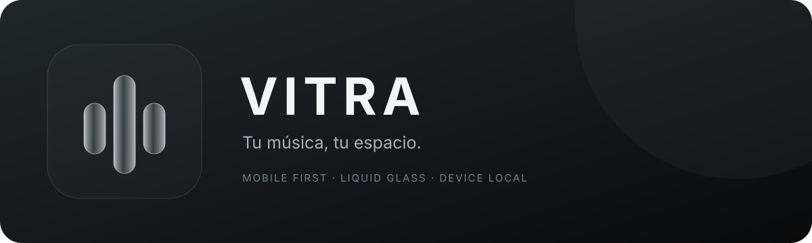
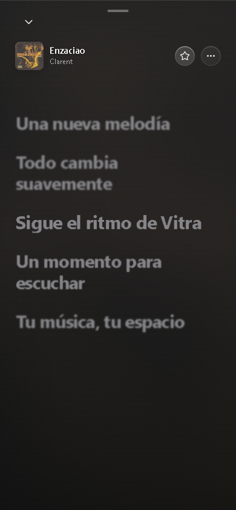
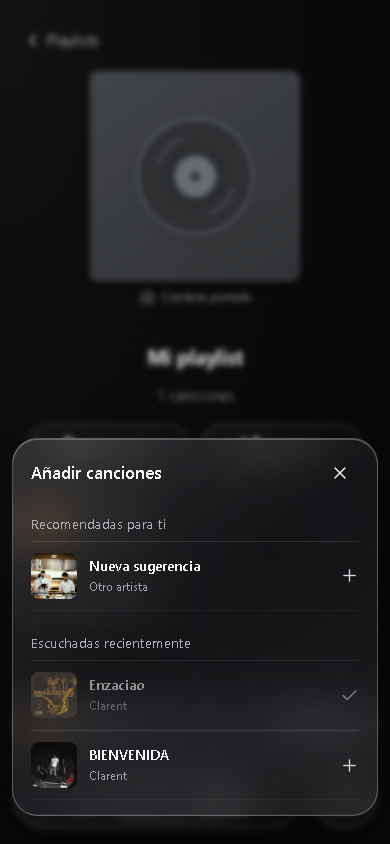
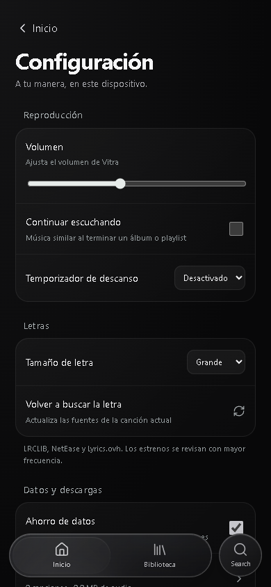
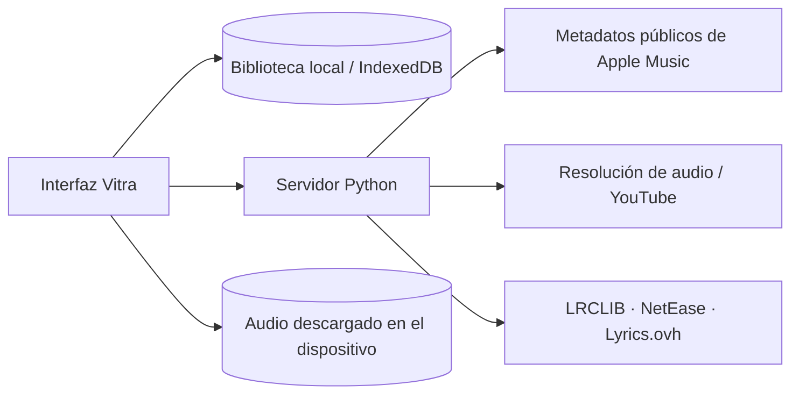

<div align="center">



**Un reproductor personal con una interfaz Liquid Glass, descubrimiento musical y biblioteca local.**


[Explorar funciones](#una-experiencia-centrada-en-la-música) · [Empezar](#ejecutar-vitra) · [Probar en iPhone](#iphone-e-ipa) · [Cómo funciona](#cómo-funciona) · [Preguntas frecuentes](#preguntas-frecuentes)

</div>

> **Estado del proyecto:** versión de desarrollo para pruebas personales. La interfaz y el servidor funcionan juntos; el cliente iPhone es un contenedor experimental de esa interfaz. No es una aplicación publicada en App Store ni una IPA firmada de forma permanente.

## Una experiencia centrada en la música

| Descubrir | Escuchar | Hacerla tuya |
| --- | --- | --- |
| Tendencias regionales y selecciones según tus escuchas | Reproductor ampliado, minirreproductor y Reproducir después | Playlists con portada propia y biblioteca sin cuenta |
| Perfiles de artistas, álbumes y lanzamientos | Letras a pantalla completa, resaltado progresivo y navegación por línea | Historial, favoritas, estadísticas y copias manuales |
| Recomendaciones mezcladas con música ya escuchada | Descargas locales, repetición y aleatorio | Volumen, temporizador, tamaño de letras y ahorro de datos |

### Detalles que hacen la diferencia

- **Diseño Liquid Glass:** superficies translúcidas, iconos coherentes y transiciones suaves entre la navegación compacta y completa.
- **Inicio personal:** las selecciones se construyen con el tiempo escuchado, reproducciones, favoritas y omisiones. Una biblioteca nueva comienza con tendencias regionales; no hereda los gustos de otra persona.
- **Playlists:** portada gris con disco por defecto, imagen personalizada, botones compactos de reproducción y sugerencias con portada, artista e historial reciente.
- **Artistas:** foto y banner diferenciados, vídeo oficial cuando la fuente lo ofrece, álbumes y canciones en carruseles horizontales.
- **Letras inmersivas:** canción fija arriba y texto en el resto de la pantalla. Toca la portada para volver al reproductor. Toca una línea para buscar su posición.
- **Tu resumen musical:** estadísticas por semana, mes y año, generadas con las escuchas registradas en el dispositivo.

<details>
<summary><strong>Ver algunas pantallas</strong></summary>

Las imágenes son capturas de desarrollo. Algunos textos y datos son fixtures de prueba; no representan una cuenta real ni todas las revisiones posteriores de la interfaz.

| Letras inmersivas | Sugerencias para playlists | Configuración |
| :---: | :---: | :---: |
|  |  |  |

</details>

## Ejecutar Vitra

### En tu equipo

Requisitos: **Python 3.12 o posterior** y **Node.js 24** disponible en el PATH. Node se utiliza como motor JavaScript para la resolución de algunas fuentes de audio, no para construir la interfaz.

```bash
python -m venv .venv
```

Activa el entorno:

```powershell
# Windows PowerShell
.venv\Scripts\Activate.ps1
```

```bash
# macOS / Linux
source .venv/bin/activate
```

Instala las dependencias e inicia el servidor:

```bash
python -m pip install -r requirements.txt
python server.py --host 127.0.0.1 --port 4203
```

Abre **http://127.0.0.1:4203/**. No necesitas crear una cuenta de Vitra. La búsqueda y el streaming necesitan conexión a Internet.

### Con Docker

```bash
docker build -t vitra .
docker run --rm -p 4203:10000 vitra
```

La biblioteca sigue estando en el navegador. La caché del servidor dentro de un contenedor desechable no es persistente.

### En Render

El archivo [`render.yaml`](render.yaml) describe un servicio Docker con el plan Free y un chequeo en `/healthz`.

1. Conecta este repositorio a Render y crea un Blueprint.
2. Revisa que el servicio elegido sea **Free**, sin disco ni base de datos de pago.
3. Espera al despliegue y comprueba `https://TU-SERVICIO/healthz`.
4. Prueba también búsqueda, perfiles y una canción nueva: un chequeo de salud correcto no valida la reproducción.

**Límite relevante:** Render puede suspender servicios gratuitos inactivos y perder su caché en reinicios. Las fuentes de audio pueden bloquear direcciones de centros de datos. El funcionamiento del streaming en ese alojamiento debe validarse; no se garantiza por el hecho de que Docker arranque. Consulta las [condiciones actuales de Render Free](https://render.com/docs/free).

## iPhone e IPA

Hay dos formas distintas de probar Vitra:

| Opción | Necesita firma | Qué estás probando |
| --- | --- | --- |
| Safari → Añadir a pantalla de inicio | No | La aplicación web con un servidor HTTPS accesible |
| Proyecto de [`ios/`](ios/) → Xcode o IPA para Sideloadly | Sí, al instalar en un dispositivo | Un contenedor iOS experimental con WKWebView |

### Generar una IPA de prueba

El flujo **Build iPhone preview** en GitHub Actions compila para dispositivo y empaqueta `Vitra-unsigned.ipa`. Se ejecuta al actualizar el proyecto iOS o manualmente. Tras una compilación correcta, publica el resultado en **Releases** y en **Actions → ejecución → Artifacts**. **No basta con que el workflow exista:** hasta que una ejecución termine correctamente, no hay una IPA compilada disponible.

La IPA generada **no está firmada**. Está preparada para que una herramienta como Sideloadly la firme para tu dispositivo; no se instala directamente desde Safari. El código y el proceso se explican en [`docs/IPHONE.md`](docs/IPHONE.md).

También puedes compilar desde un Mac con Xcode, elegir tu equipo de firma y ejecutar en el iPhone conectado. Una cuenta gratuita no proporciona una instalación permanente. Para distribución firmada y sus restricciones, revisa la [documentación de Apple](https://developer.apple.com/documentation/xcode/running-your-app-on-simulated-or-physical-devices).

> **Pruebas pendientes:** la compilación iOS y su ejecución en iPhone físico deben verificarse. El contenedor necesita la dirección HTTPS de tu servidor. No sustituye al backend ni convierte automáticamente el audio web en reproducción nativa en segundo plano.

## Cómo funciona



### Catálogo y reproducción

- El catálogo y la presentación de artistas se enriquecen con datos públicos de Apple Music e iTunes. El orden de Top Songs corresponde al que ofrece la fuente; **no se publican cifras privadas de reproducciones de Apple**.
- La fuente de audio se resuelve mediante YouTube y `yt-dlp`. La app comprueba título, artista, versión y duración para reducir coincidencias incorrectas, pero todavía pueden existir errores o contenido no disponible.
- El servidor comparte descargas en curso, sirve rangos de bytes y reutiliza archivos completos. La precarga del siguiente tema y las cachés reducen espera; una canción nunca resuelta no puede garantizarse instantánea.
- Los vídeos de los banners son visuales y se reproducen sin sonido. Se pausan fuera de vista, al ocultar la app o al activar ahorro de datos.

### Recomendaciones

Vitra tiene su **propio sistema de recomendaciones**. Combina señales locales del usuario con catálogos y tendencias públicas. No replica el algoritmo privado de Apple Music ni el de Spotify.

Las sugerencias no se convierten automáticamente en escuchas o favoritas. Se filtran canciones y artistas ocultos y se limita la repetición de artistas en varias vistas.

### Letras y animación

Se consultan **LRCLIB, NetEase y Lyrics.ovh**, con alternativas, caché y reintentos más frecuentes para canciones recientes.

- Si hay tiempos por palabra, se conservan.
- Si solo hay tiempos por línea, la animación entre palabras se estima localmente.
- Si únicamente existe texto plano, puede usarse una progresión visual estimada en la duración del audio.
- La estimación **no reconoce la voz** ni garantiza alineación exacta con el cantante. Ninguna fuente garantiza letras para todos los estrenos.
- La vista se actualiza con el reloj del audio, respetando pausas y saltos. Los efectos de movimiento se reducen con la preferencia de accesibilidad del dispositivo.

### Datos y privacidad

| Dato | Dónde se guarda |
| --- | --- |
| Playlists, favoritas, historial, gustos y estadísticas | IndexedDB del dispositivo/origen web |
| Portadas elegidas por el usuario | Almacenamiento local de la biblioteca |
| Audio descargado | IndexedDB de descargas del dispositivo |
| Caché de catálogo, letras y audio del servidor | Carpeta `cache/` del backend |
| Claves de servicios opcionales | Variables privadas del servidor |

No hay una cuenta de Vitra ni sincronización de bibliotecas entre personas. Eso no convierte al backend en un servicio privado: el servidor procesa consultas musicales y se conecta con proveedores externos; el alojamiento puede registrar solicitudes.

**Crea copias manuales antes de borrar datos del navegador, cambiar de dominio o desinstalar.** El archivo de copia incluye biblioteca, estadísticas, preferencias y portadas; **no incluye el audio descargado**. El almacenamiento de un origen no se comparte automáticamente con otro navegador, otro dominio o el contenedor iOS.

## Importar playlists

| Método | Estado |
| --- | --- |
| Archivo CSV, TSV, JSON o XML compatible | Disponible; se buscan coincidencias en el catálogo |
| Spotify oficial | Requiere registrar una app y configurar su conexión |
| Apple Music oficial | Requiere configurar MusicKit y autorización del usuario |

La importación busca equivalencias y puede omitir temas no encontrados o versiones incorrectas. No transfiere archivos protegidos ni garantiza que todos los temas tengan audio disponible.

<details>
<summary><strong>Variables opcionales para conexiones oficiales</strong></summary>

```dotenv
SPOTIFY_CLIENT_ID=
SPOTIFY_REDIRECT_URI=https://TU-SERVIDOR/
APPLE_MUSIC_DEVELOPER_TOKEN=
```

Configura estas variables en el entorno del servidor. No publiques claves privadas `.p8`, contraseñas ni tokens de usuario. El frontend recibe el token de desarrollador de MusicKit cuando se configura esa integración; la clave privada que lo firma debe permanecer en el servidor.

MusicKit y la API pública de Spotify no se usan como fuentes de texto completo de letras. Musixmatch tampoco está conectado en esta versión.

</details>

## Estado de las pruebas

Las pruebas locales de desarrollo comprobaron biblioteca y copias, importación, temporizador, letras y saltos de tiempo, cambios rápidos de canción, reproducción sin red con audio sintético, geometría móvil y transformaciones de la barra inferior. Se probaron perfiles y reproducción real en navegador.

Esto **no equivale** a una certificación en todos los dispositivos. El archivo [`docs/TESTING.md`](docs/TESTING.md) contiene una lista de comprobación para cada publicación. Las validaciones automatizadas del repositorio comprueban sintaxis, una batería mínima y el endpoint de salud; la compilación iOS usa un flujo separado.

## Estructura del proyecto

```text
.
├── app.js / index.html       Interfaz móvil
├── device-client.js          Biblioteca y copias locales
├── audio.js / offline.js     Reproductor y descargas
├── library-tools.js          Importación y resumen musical
├── server.py                 HTTP, catálogo y audio
├── apple_catalogue.py        Metadatos de artistas y álbumes
├── lyrics_service.py         Proveedores de letras
├── streaming_audio.py        Carga progresiva y rangos
├── ios/                      Contenedor experimental para iPhone
├── scripts/                  Comprobaciones y compilación
├── docs/                     Instalación, pruebas y capturas
└── .github/workflows/         Validación y compilación manual de iOS
```

## Preguntas frecuentes

<details>
<summary><strong>¿Es gratis y funciona sin cuenta?</strong></summary>

La biblioteca no necesita una cuenta de Vitra. El coste del alojamiento y de los servicios externos depende del proveedor y del plan que contrates. Los flujos de GitHub Actions consumen minutos de compilación según la cuota de tu cuenta; no se activa un mecanismo para eludir límites gratuitos.

</details>

<details>
<summary><strong>¿La IPA incluye el servidor?</strong></summary>

No. El contenedor iPhone carga tu despliegue HTTPS de Vitra. Tu PC debe permanecer encendida si actúa como servidor; con un alojamiento remoto no depende de tu PC, pero sí de ese servicio. `127.0.0.1` en el iPhone se refiere al propio teléfono, no a tu computadora.

</details>

<details>
<summary><strong>¿Puedo escuchar sin Internet?</strong></summary>

Las canciones descargadas se pueden reproducir desde el almacenamiento del dispositivo mientras la interfaz esté disponible. La búsqueda, los temas no descargados y los metadatos nuevos requieren red. El arranque en frío y el modo sin conexión del contenedor iOS deben probarse en un iPhone real; no se prometen equivalentes a un reproductor nativo con toda la interfaz empaquetada.

</details>

<details>
<summary><strong>¿Por qué faltan letras o tarda una canción nueva?</strong></summary>

Los proveedores pueden no haber incorporado la letra o la fuente de audio, rechazar una solicitud o limitar el servicio. Vitra prueba alternativas y conserva caché; no inventa una letra cuando falta ni garantiza carga instantánea.

</details>

<details>
<summary><strong>¿Puedo compartir el enlace del servidor?</strong></summary>

La biblioteca de cada dispositivo es independiente. El backend actual no incluye autenticación ni cuotas por usuario: quien conozca el enlace puede usar sus rutas de música. Para una distribución amplia hacen falta controles adicionales de acceso, uso y disponibilidad.

</details>

## Créditos y uso

Vitra es un proyecto independiente. No está afiliado a Apple, Spotify, YouTube, NetEase ni a los proveedores de letras. Nombres, portadas, música y letras pertenecen a sus respectivos titulares; utiliza las fuentes según sus condiciones y los permisos aplicables. HLS.js y Lucide conservan sus licencias de terceros; consulta [`THIRD_PARTY_NOTICES.md`](THIRD_PARTY_NOTICES.md).

No se ha añadido una licencia de distribución al código propio del proyecto. Su publicación en un repositorio no concede automáticamente una licencia de código abierto.
